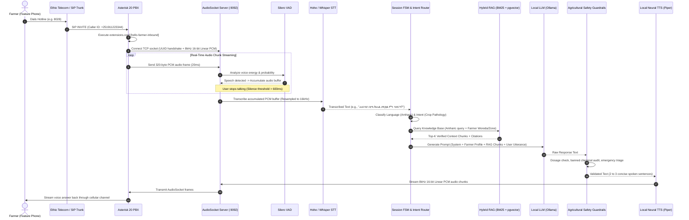
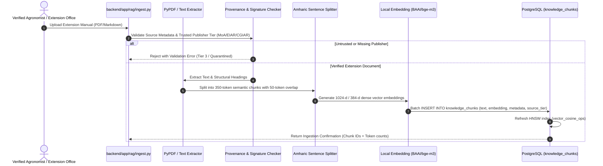
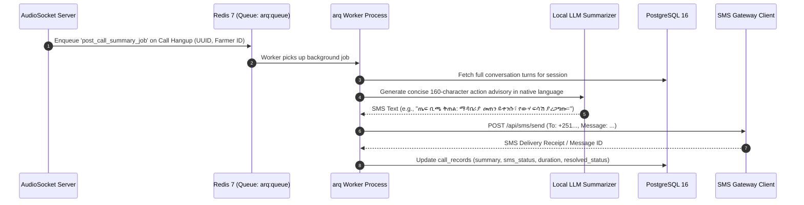

# Hello Farmer: System Dependency & Data Flow Map

This document maps all internal runtime services, local machine learning models, external upstream services, data flow pipelines, and degradation modes across the Hello Farmer voice intelligence platform.

---

## 1. System Topology & Inter-Service Dependency Graph

```mermaid
flowchart TD
    subgraph Telecom & Voice Ingress
        PSTN["Cellular / Landline Network (Ethio Telecom / Safaricom)"]
        SIP["SIP Trunk / Gateway"]
        PSTN -->|E1/SIP Voice Call| SIP
    end

    subgraph Telephony Infrastructure
        AST["Asterisk 20 PBX (Container: hello_farmer_asterisk)"]
        SIP -->|SIP UDP 5060 / RTP 10000-10020| AST
    end

    subgraph Core Backend Application
        AUD["AudioSocket TCP Server (Port 9092)"]
        API["FastAPI HTTP Server (Port 8000)"]
        WS["FastAPI WebSocket (/ws/voice-chat)"]
        ROUTER["Deterministic Intent Router & Session FSM"]
        VAD["Silero VAD (Voice Activity Detector)"]
        ASR_ROUTER["STT Router & Engine"]
        RAG_ENGINE["Hybrid RAG (BM25 + pgvector + RRF)"]
        LLM_ENGINE["Local LLM Inference Engine"]
        GUARD["Agricultural Safety Guardrails"]
        TTS_ROUTER["Local TTS Pipeline"]

        AST -->|TCP Audio Stream (UUID + 8kHz/16-bit PCM)| AUD
        AUD --> VAD
        VAD --> ASR_ROUTER
        ASR_ROUTER --> ROUTER
        ROUTER --> RAG_ENGINE
        ROUTER --> LLM_ENGINE
        LLM_ENGINE --> GUARD
        GUARD --> TTS_ROUTER
        TTS_ROUTER -->|TCP 8kHz Audio Frames| AUD
        AUD -->|AudioSocket| AST

        API --- ROUTER
        WS --- ROUTER
    end

    subgraph Persistence & Task Queues
        PG[("PostgreSQL 16 + pgvector (Container: hello_farmer_postgres)")]
        REDIS[("Redis 7 (Container: hello_farmer_redis)")]
        WORKER["arq Async Background Worker (Container: hello_farmer_worker)"]

        RAG_ENGINE <-->|HNSW Cosine Vector Search & Lexical Query| PG
        ROUTER <-->|Farmer Profile & Call Session State| PG
        ROUTER <-->|Redis Session Locks & Cached FAQs| REDIS
        API -->|Enqueue Post-Call Task| REDIS
        REDIS -->|Dequeue Job| WORKER
        WORKER -->|Save Analytics & Transcripts| PG
    end

    subgraph Web User Interface
        FE["Next.js 14 Frontend (Container: hello_farmer_frontend, Port 3000)"]
        FE <-->|REST & SSE Admin Dashboard| API
        FE <-->|WebSocket Real-Time Voice Audio| WS
    end

    subgraph External & Local AI Model Providers
        OLLAMA["Local Ollama Service (Port 11434, Qwen2.5 / Llama-3.1)"]
        GEMINI["Gemini API (Optional Cloud Fallback)"]
        OPEN_METEO["Open-Meteo API (Free Ag Weather)"]
        SMS_GW["Ethio Telecom / Africa's Talking SMS API"]

        LLM_ENGINE -->|Primary Local| OLLAMA
        LLM_ENGINE -.->|Optional Internet Fallback| GEMINI
        ROUTER -->|Real-time Microclimate| OPEN_METEO
        WORKER -->|Advisory Dispatch| SMS_GW
    end
```

---

## 2. Machine Learning Model Dependencies

| Task / Domain | Model Architecture | Default Local Provider | Primary Artifact / Repository | Offline Feasible | Hardware Footprint |
| :--- | :--- | :--- | :--- | :--- | :--- |
| **Amharic ASR** | Wav2Vec2-BERT / Conformer-CTC | `snapwre/hohe-asr-amharic` (HuggingFace) or local fine-tuned Whisper | Hugging Face Hub / ONNX / Torchscript | **Yes** (cached weights) | ~1.2 GB VRAM or 4-core CPU (AVX2) |
| **Afaan Oromoo ASR** | Whisper Small / CTC Fine-tuned | `openai/whisper-small` / Oromo acoustic checkpoint | Local Hugging Face directory | **Yes** | ~2.0 GB VRAM or 4-core CPU |
| **English ASR** | Whisper Base | `openai/whisper-base` | Hugging Face / Faster-Whisper | **Yes** | ~500 MB VRAM |
| **Voice Activity Detection** | Silero VAD v4 | Local ONNX Runtime | `silero_vad.onnx` bundled in package | **Yes** | Minimal (< 50 MB RAM, < 5% CPU core) |
| **Multilingual Embeddings** | Transformer Encoder (1024-d / 384-d) | `BAAI/bge-m3` or `paraphrase-multilingual-MiniLM-L12-v2` | SentenceTransformers cache / HuggingFace | **Yes** (with fallback to `DeterministicSubwordEmbeddingProvider`) | ~1.5 GB VRAM or 2 GB RAM |
| **Lexical Search (BM25)** | In-memory Inverted Index | Custom Amharic/Oromo Stemming + Ge'ez Tokenizer | Internal Python module (`backend/app/rag/retrieve.py`) | **Yes** (Zero external models) | ~100 MB RAM |
| **Local LLM Generation** | Quantized Decoder-Only (GGUF / Ollama) | `Qwen2.5:7b-instruct-q4_K_M` or `Llama-3.1:8b-instruct-q4_K_M` | Ollama runtime or llama.cpp server | **Yes** | 4.8 GB VRAM (GPU) or 8 GB RAM (CPU) |
| **Cloud LLM Fallback** | Gemini Flash / Pro | Google Gemini REST API | `google-genai` Python SDK | No (Requires Internet) | Nil (Remote API) |
| **Local Amharic TTS** | VITS / Piper ONNX Neural Speech | Piper Amharic (`am_ET`) checkpoint | ONNX Runtime / `piper-tts` binary | **Yes** | ~150 MB RAM, Real-Time Factor < 0.25 |
| **Cloud TTS Fallback** | Edge-TTS Neural Speech | `am-ET-MekdesNeural` / `am-ET-AmehaNeural` | Microsoft Azure Speech CDN via WebSocket | No (Requires Internet) | Network-bound |

---

## 3. End-to-End Data Flow Pipelines

### 3.1. Telephony Inbound Voice Call Flow (Asterisk -> AudioSocket -> RAG -> TTS)



### 3.2. Knowledge Base Ingestion Pipeline



### 3.3. Asynchronous Post-Call Advisory & SMS Follow-up Pipeline



---

## 4. Internal Python Module Dependency Hierarchy

The Python backend within `backend/app/` follows a strict layered dependency hierarchy. Cyclic dependencies are prohibited.

```
Layer 0: Core Foundation & Configuration
  └── app/config.py (Pydantic BaseSettings, Environment variables)
  └── app/db/session.py (SQLAlchemy async engine & sessionmaker)

Layer 1: Domain Entities & Database Models
  └── app/db/models.py (Farmer, CallRecord, KnowledgeChunk, AdvisoryRecord)
  └── app/schemas/ (Pydantic request/response schemas)

Layer 2: Specialized Domain Services (Leaf Services)
  └── app/services/weather.py (Open-Meteo HTTP Client)
  └── app/services/translation.py (NLLB / Marian offline translation)
  └── app/services/sms.py (SMS Gateway Integration)
  └── app/stt/ (whisper_local.py, hohe_asr.py, silero_vad.py)
  └── app/tts/ (piper_local.py, edge_tts_service.py)
  └── app/rag/embed.py (DeterministicSubword, LocalSentenceTransformer)

Layer 3: Compound Domain Logic & Retrieval
  └── app/rag/retrieve.py (BM25 lexical search + pgvector Cosine + RRF + Agro-boosting)
  └── app/rag/ingest.py (Document parsing, chunking, provenance validation)
  └── app/llm/client.py (Ollama local inference + Gemini fallback)
  └── app/llm/guardrails.py (Safety checks, dosage verification, triage)

Layer 4: Orchestration & Session FSM
  └── app/telephony/call_flow.py (AudioSocket framing, VAD chunking, conversational state machine)
  └── app/services/farmer_service.py (Farmer profile matching and history aggregation)

Layer 5: Presentation & Ingress
  └── app/main.py (FastAPI HTTP Routes & WebSockets)
  └── app/telephony/audiosocket.py (TCP Socket Daemon)
  └── worker.py (arq asynchronous job definitions)
```

---

## 5. Failure Modes & Cascading Degradation Strategies

| Component | Failure Condition | Immediate Impact | Degraded Recovery Path |
| :--- | :--- | :--- | :--- |
| **Internet Connectivity** | External WAN connection drops | Gemini API and Open-Meteo unavailable | System automatically engages **Pure Offline Mode**: Ollama runs local inference; cached regional climatology substituted for live weather; Piper generates local voice. Call remains uninterrupted. |
| **Local GPU / CUDA** | OOM or Driver Crash | High inference latency on GPU models | Ollama and Piper fall back to quantized CPU inference (`num_threads=4`, `q4_k_m`). AudioSocket increases VAD buffer leeway. |
| **Primary ASR (Hohe)** | High acoustic noise or dialect failure | Confidence score drops below threshold (< 0.45) | AudioSocket asks caller for repetition in native language: *"ይቅርታ፣ ድምፅዎ አልተሰማኝም፤ እባክዎ እንደገና ይናገሩ?"* System never injects mock transcripts. |
| **PostgreSQL Database** | Storage full or connection pool exhausted | New call records and chunk searches fail | Redis session cache maintains in-flight conversation state; RAG falls back to in-memory FAQ cache (`faq_cache.json`). Call is gracefully completed. |
| **Redis Queue** | Redis process restart | Post-call SMS jobs delayed | Worker uses persistent disk-backed AOF log; jobs retry automatically with exponential backoff on reconnection. |
| **Asterisk PBX** | AudioSocket disconnects abruptly | Caller drops mid-sentence | AudioSocket server catches `ConnectionResetError`, cleans up in-flight session buffers, commits partial transcript to database, and frees memory. |

---

*Verified and cross-referenced with `docs/architecture/EXISTING_SYSTEM_AUDIT.md` and `docs/architecture/TARGET_ARCHITECTURE.md`.*
