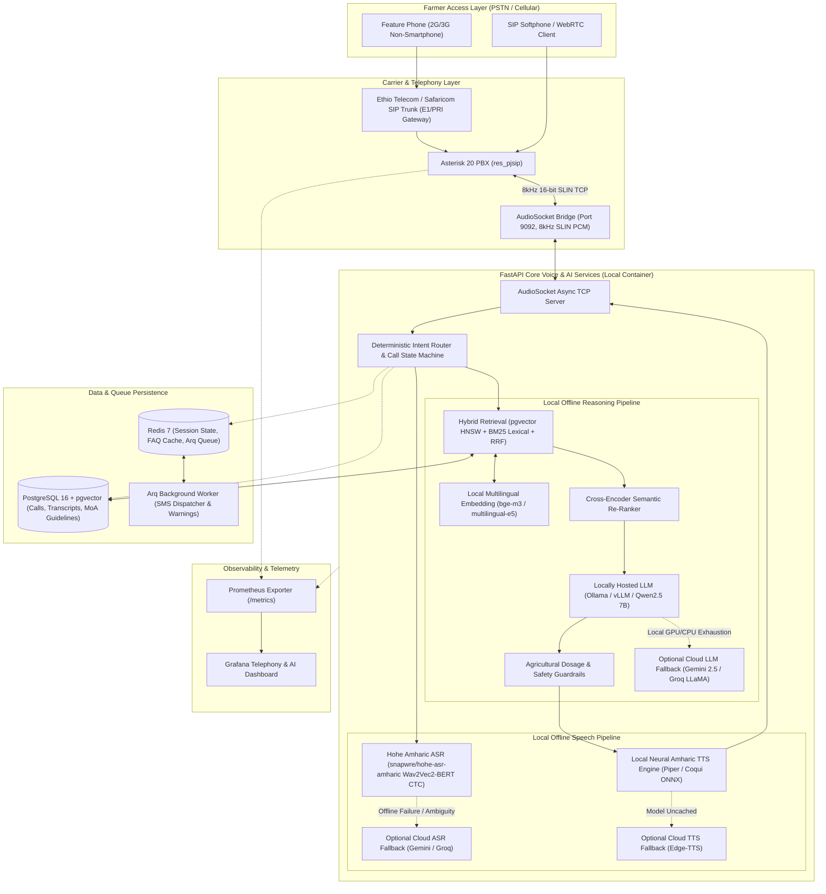

# Hello Farmer: Target Architecture Specification

**Specification Version:** 2.0-Production-Offline-Capable  
**Status:** Approved Target Architecture  
**Primary Focus:** Low-latency, locally deployable, multilingual voice advisory platform for Ethiopian smallholder farmers.

---

## 1. High-Level System Architecture

The target architecture decouples core agricultural voice intelligence from mandatory external cloud dependencies, enabling Hello Farmer to operate either **fully offline on local infrastructure** or in a **hybrid edge-cloud configuration**.

---

## 2. Subsystem Target Specifications

### 2.1 Telephony Subsystem
* **Core Software**: Asterisk 20 LTS compiled with `app_audiosocket`, `chan_audiosocket`, and `res_pjsip`.
* **Carrier Interconnect**:
  - Emulates national shortcode `8028` on internal dialplan.
  - Documented carrier SIP trunk configuration with Ethio Telecom / Safaricom (digest authentication or IP whitelisting).
* **Media Protocol**: AudioSocket over TCP (Port 9092). Single TCP connection per active channel streaming 8 kHz 16-bit mono signed linear PCM.
* **Audio Continuity**: Continuous 20ms silence frame keepalive injection during LLM reasoning; full-duplex incoming frame drainage to prevent buffer overflow.

### 2.2 Speech Recognition (ASR / STT)
* **Primary Amharic Engine**: **Hohe Amharic ASR** (`snapwre/hohe-asr-amharic`).
  - Architecture: Wav2Vec2-BERT fine-tuned with Connectionist Temporal Classification (CTC).
  - Character-level alignment: Zero repetition token hallucination loops (unlike autoregressive Whisper models).
  - Deployment: Local PyTorch CPU / quantized ONNX runtime inside container.
* **Secondary Engine (Afaan Oromoo & English)**:
  - Local quantized Whisper model (`whisper-base-int8` / `faster-whisper`) with pre-cached model weights.
* **Tertiary Fallback (Cloud-Assisted)**:
  - Groq Whisper-large-v3 and Google Gemini 2.5 Flash Lite with domain prompt priming.
  - **Strict Rule**: When local and cloud ASR fail, return explicit error status to trigger spoken clarification; NEVER return fixed canned transcripts.

### 2.3 Speech Synthesis (TTS)
* **Primary Amharic Engine**: Approved Local Offline Amharic TTS (Piper / Coqui Amharic neural checkpoint).
  - Generates true 8 kHz or 16 kHz acoustic speech directly on local host.
  - Zero external bandwidth required.
* **Secondary Engine**: Microsoft Edge-TTS neural voices (`am-ET-AmehaNeural`, `om-ET`).
* **Telephony Prompts**: Static call-flow prompts (greetings, holding cues, goodbyes) pre-rendered to 8 kHz WAV files in `backend/cache/prompts/` to ensure 0ms playback latency.

### 2.4 Conversation Management & Intent Routing
* **State Machine**: Deterministic finite state machine:
  `GREETING` $\rightarrow$ `LOCATION_COLLECTION` $\rightarrow$ `LOCATION_CLARIFICATION` $\rightarrow$ `AGRICULTURAL_QUERY` $\rightarrow$ `KNOWLEDGE_RETRIEVAL` $\rightarrow$ `RESPONSE_GENERATION` $\rightarrow$ `CLOSING` $\rightarrow$ `COMPLETED`.
* **Barge-in Support**: Sub-200ms VAD energy interruption allowing caller speech to truncate bot playback immediately.
* **Session Persistence**: Redis-backed session state capturing caller phone hash, language, location, crop, and turn history.

### 2.5 Agricultural Knowledge Retrieval (Hybrid RAG)
* **Dense Vector Search**: PostgreSQL 16 `pgvector` with HNSW index (`vector_cosine_ops`, $M=16, efSearch=64$).
* **Sparse Lexical Search**: BM25 keyword matching for exact vernacular crop, weed, and chemical names (*"ኩትክዋቶ"*, *"ዋግ"*, *"ዳፕ"*, *"ዩሪያ"*).
* **Rank Fusion**: Reciprocal Rank Fusion (RRF with $k=60$) combining dense and lexical ranks.
* **Geographic & Agroecological Reranker**:
  - Locality Match (Woreda/Town): $+0.20$
  - Regional Zone Match: $+0.12$
  - Agroecological Zone Match (*Dega*, *Woina Dega*, *Kolla*): $+0.08$

### 2.6 Large Language Model (LLM) Reasoning
* **Primary Engine**: Locally hosted open-weights model:
  - Engine: Ollama / vLLM running `Qwen2.5-7B-Instruct` or `Llama-3.1-8B-Instruct`.
  - Format: Strictly valid JSON output adhering to Pydantic schema (`answer`, `answer_en_gloss`, `grounded`, `needs_referral`).
* **Secondary Fallback**: Cloud-hosted Groq LLaMA 3.3 70B or Google Gemini 2.5 Flash.
* **Spoken Formatting**: Enforce mandatory conversion of all Arabic numerals (0-9) to written target language words (e.g. Amharic *"ሁለት"*, Oromo *"lama"*).

### 2.7 Agricultural Safety Guardrails
* **Zero Chemical Hallucination Policy**: Prohibit unverified synthetic chemical dosages or mixing ratios.
* **DA Referral**: Attach mandatory Kebele DA referral advice to all chemical recommendations.
* **Emergency Poisoning Detector**: Identify toxic ingestion and immediate veterinary/hospital redirection.

### 2.8 Observability & Telemetry
* **Prometheus Exporter**: Expose `/metrics` tracking:
  - Call connection count, duration, and Answer Seizure Ratio (ASR).
  - P50, P95, and P99 latency across VAD, STT, RAG, LLM, and TTS.
  - ASR word error rate and chemical guardrail trigger count.
* **Grafana Dashboard**: Pre-configured dashboards for real-time monitoring of agricultural voice calls.
